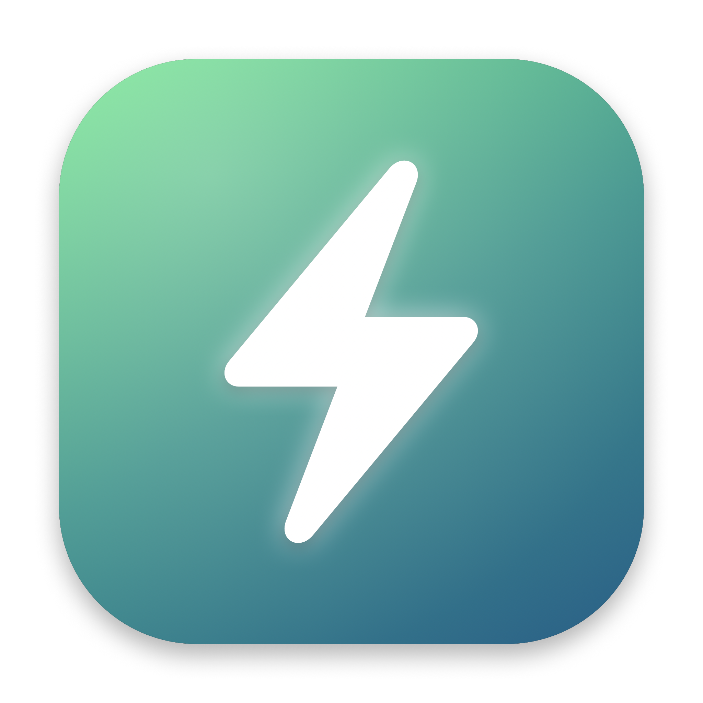
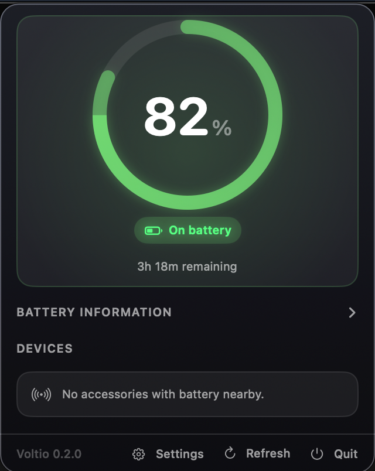
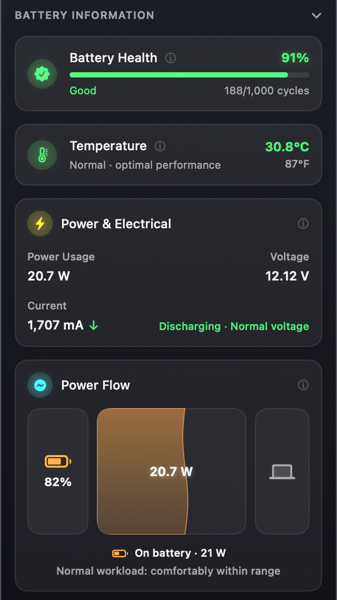
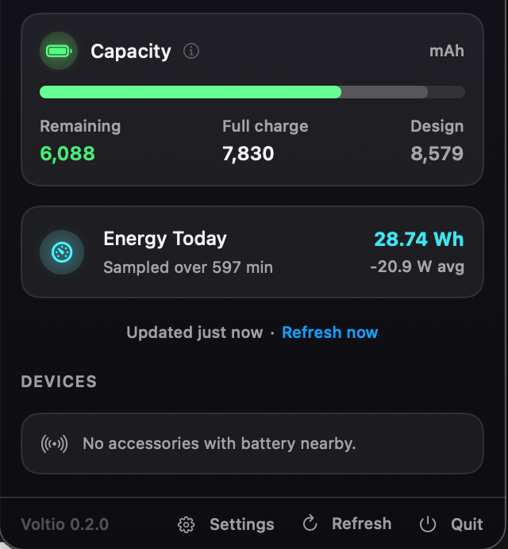
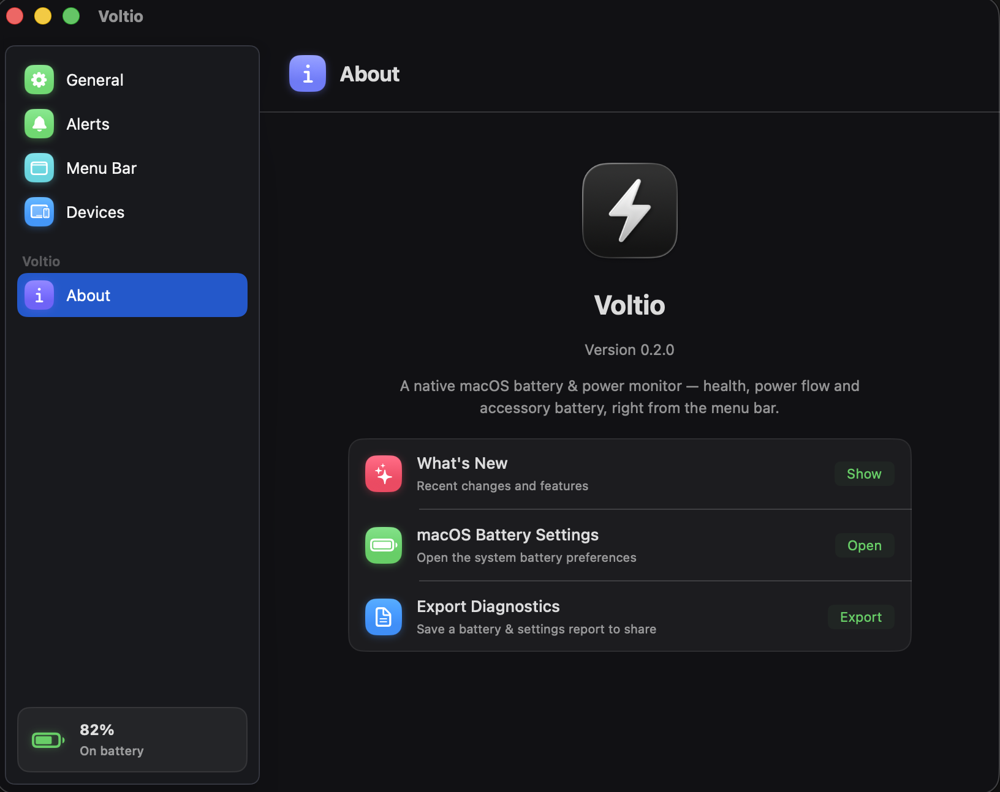

<p align="center">
  
</p>

<h1 align="center">Voltio</h1>

<p align="center">
  A native macOS menu-bar battery &amp; power companion — clean, fast, and entirely local.
  <br/>
  <sub>battery widget · menu bar monitor · AirPods &amp; accessory battery · power stats · charge-limit status — free &amp; open source</sub>
</p>

<p align="center">
  
  
  
  
</p>

---

Voltio lives in your menu bar and surfaces deep battery and power telemetry for your
Mac and its connected accessories: live charge level, a real-time power-flow
visualization, battery for Bluetooth/USB peripherals (AirPods, Magic devices, iPhone,
iPad), and highly customizable on-screen alerts with sound and screen glow.

It is built from scratch in **Swift 6** with **SwiftUI + AppKit**, runs as a lightweight
menu-bar agent, and makes **zero network calls** — all telemetry stays on your machine.

## Features

### Menu bar
- Live battery **percentage**, **time remaining**, or charging state in the menu bar.
- Three icon styles — **Battery Indicator**, **Minimal**, and **Voltio Logo** (with an animated glowing bolt while charging).
- Optional status tint: green while charging, orange when low, red when critical.
- **Instant** plug/unplug response via IOKit power-source notifications (no polling lag).

### Battery details
- Charge level, charging/plugged state, and time to full / time to empty.
- Health as a percentage of original capacity (matching the Maximum Capacity macOS reports), plus cycle count, current/max/design capacity (mAh), temperature, voltage, and amperage.
- Adapter wattage and name, system power draw, and net battery power (watts).

### Power flow
- A live visualization of where the watts go: **adapter → battery / system split → connected devices**, with animated liquid-fill bars, the current battery %, and a power summary.

### Connected devices
- Battery levels for Bluetooth/USB accessories — **AirPods, Beats, Magic Mouse / Keyboard / Trackpad** (HID + Apple Continuity BLE decoding).
- **iPhone / iPad** battery via the Bluetooth GATT Battery Service.
- Device history: remembers your accessories and keeps showing them when offline, with a "last seen" indicator.

### Alerts
- Configurable rules for **low**, **critical**, and **fully charged** thresholds (with hysteresis to avoid flapping).
- Power-event alerts for **charger connected / disconnected** — the color reflects your actual battery %, not a fixed warning hue.
- **Per-device** low-battery alerts.
- A modern on-screen alert bubble with a spring drop-in animation and an animated running border; adjustable **size** and **on-screen duration** (2–8s slider).
- Screen-edge **glow** overlay (Off / Subtle / Default / Strong).
- Alert **sounds**: system sounds or your own audio files.

### Settings & behavior
- A dark, System-Settings-style preferences window.
- Refresh interval (2 / 5 / 10 / 30 s), icon style, status colors, **launch at login** (via `SMAppService`), and Dock visibility.
- **Dynamic Dock presence**: runs as a menu-bar agent, appears in the Dock when you open the main window, and returns to the menu bar when you close it.

## Screenshots

<p align="center">
  
  
</p>
<p align="center">
  
  
</p>

## Install

Download **[Voltio.dmg](https://github.com/Mohit-Sharma-ML/voltio/releases/latest)** from
Releases, open it, and drag **Voltio** into **Applications**.

> **First launch:** because the DMG is not notarized yet (a Developer ID
> certificate is required), macOS may warn that the app "can't be opened."
> Right-click **Voltio.app → Open → Open** once — after that it launches
> normally.
>
> Each release lists the DMG's **SHA-256**. Verify your download before opening
> it:
>
> ```bash
> shasum -a 256 ~/Downloads/Voltio.dmg     # compare with the release notes
> ```

## Requirements

- **macOS 15 (Sequoia)** or later.
- Apple Silicon or Intel Mac.
- To build: the **Swift 6 toolchain** (Xcode 16+ or a standalone Swift 6 toolchain).
- On first launch, Voltio asks for **Bluetooth** permission — used only to read accessory battery levels.

## Build & run

**Prerequisite:** an Apple Team ID (free Apple ID works). Copy the example
file and add yours — it configures the App Group the widgets read through
and the code-signing identity:

```bash
cp TeamID.local.example TeamID.local
# then edit TeamID.local, replacing the placeholder with your own Team ID
# (find it: Xcode → Settings → Accounts → team details)
```

```bash
# Run the test suite (pure logic in PowerCore)
swift test

# Quick debug build
swift build

# Build a runnable, signed .app bundle (reads TeamID.local)
scripts/build_app.sh release
open dist/Voltio.app
```

The Team ID is build-time configuration only — it is never hardcoded in
source. It is injected into the entitlements and Info.plists by
`scripts/build_app.sh`; the code reads it back via
`AppGroupConfiguration` (PowerCore) at runtime. Your Team ID appears in
signed builds by nature of code signing, but this repository contains no
team-specific values.

Regenerate the app icon (`Resources/AppIcon.icns`) from source:

```bash
scripts/make_icns.sh
```

## Building from source

`scripts/dist.sh` produces a Developer ID-signed, **notarized**, stapled DMG. It requires a
paid Apple Developer Program membership and a one-time credential setup (documented at the
top of the script):

```bash
DEV_ID_APP="Developer ID Application: Your Name (TEAMID)" scripts/dist.sh
# → dist/Voltio.dmg
```

Voltio runs **sandboxed** under the hardened runtime. The sandbox is required for the
widget extension: the system's widget infrastructure (pkd/chronod) only ingests
extensions whose containing app is sandboxed. Battery reads work inside the sandbox —
IORegistry (`AppleSmartBattery`), IOHID, and CoreBluetooth are all permitted without
special entitlements; Bluetooth access is gated by the standard user prompt.

## Project structure

```
.
├── Package.swift
├── Sources/
│   ├── PowerCore/      Pure, unit-tested logic: battery parsing, Continuity/GATT
│   │                   decoding, peripheral classification, device history,
│   │                   power estimation, App Group configuration.
│   ├── Voltio/         The app: SwiftUI views, AppKit windows, IOKit/BLE/HID
│   │                   integration, alerts, settings, snapshot publishing.
│   └── VoltioWidgets/  The WidgetKit extension (small + medium widgets).
├── Tests/              PowerCoreTests + VoltioTests (74 tests: XCTest + Swift Testing).
├── Resources/          App icon, Info.plists, entitlement templates.
├── assets/             Screenshots used by this README.
└── scripts/            build_app.sh · make_icns.sh · dist.sh · release_checksum.sh
```

## Architecture

Voltio is split so the logic is testable without a UI:

- **`PowerCore`** — a dependency-free library of pure functions and models: parsing raw
  IOKit battery dictionaries into a `BatterySnapshot`, decoding Apple Continuity and GATT
  battery advertisements, classifying peripherals, the device-history merge/prune rules,
  energy aggregation/power estimation, and App Group configuration.
- **`Voltio`** — the menu-bar application. It reads the Mac battery via **IOKit**
  (`AppleSmartBattery` / `IOPSCopyPowerSourcesInfo`), gets *instant* power-state changes via
  IOKit power-source run-loop notifications, scans accessories via **CoreBluetooth** and
  **IOHID**, and renders everything with SwiftUI. Alerts, the on-screen bubble/glow, and the
  menu-bar icon are driven from a single observable model; preferences persist in
  `UserDefaults`.
- **`VoltioWidgets`** — the WidgetKit extension. The app publishes a compact snapshot to a
  team-ID-prefixed App Group (`UserDefaults` suite) every few seconds; the extension reads
  it and renders two widgets (battery, battery + energy).

## Privacy

Voltio is **local-first**: no network requests, no analytics, no accounts, no telemetry.
Bluetooth is used solely to read accessory battery levels, and IORegistry/IOKit to read your
Mac's battery. Nothing leaves your device.

## Roadmap

- Published screenshots and a short demo clip.
- Localization.
- Optional in-app battery-health history over time.

## License

Voltio is released under the **MIT License** — see [`LICENSE.md`](LICENSE.md).

In short: you may use, copy, modify, merge, publish, distribute, sublicense,
and sell Voltio, provided the copyright notice accompanies the software.
Contributions are welcome and are assumed licensed under MIT as well.

## Contributing

Issues and pull requests are welcome. Please keep changes focused,
add tests for anything in `PowerCore`, and run `swift test` before opening a PR.

## Acknowledgements

Voltio is an independent, original project. All referenced product names and
trademarks belong to their respective owners.
